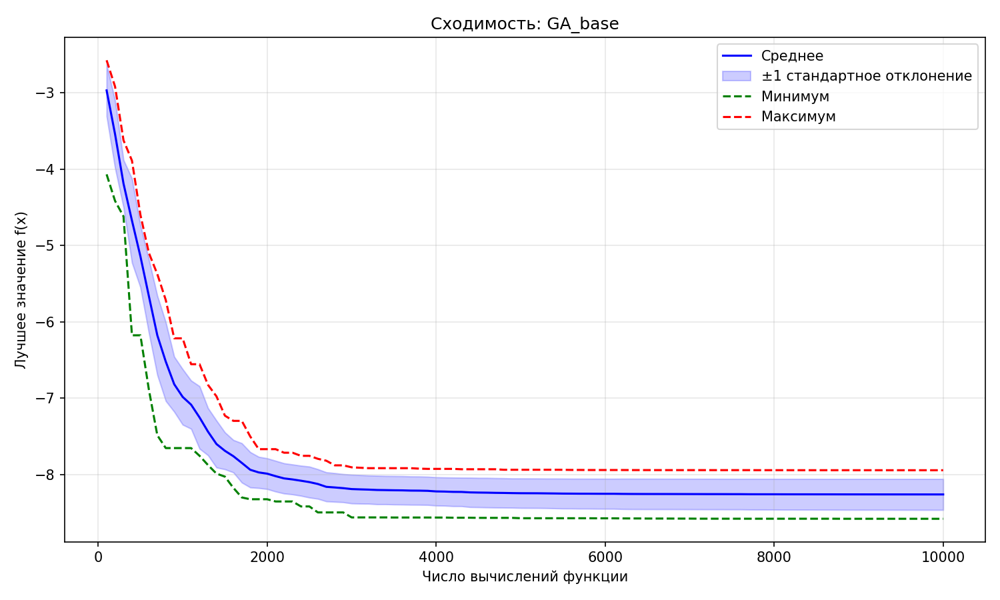
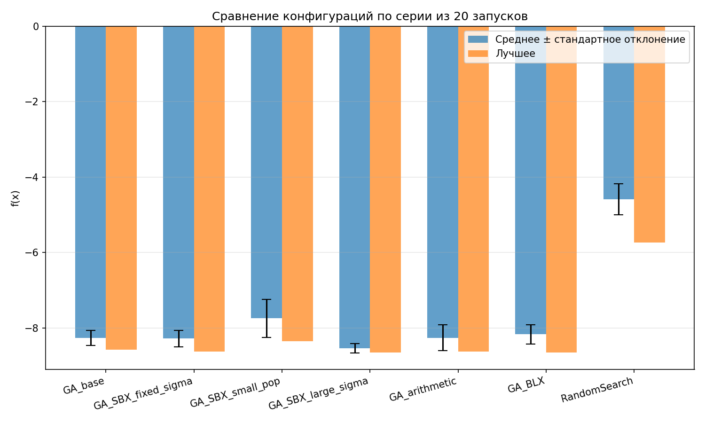

# Отчёт по лабораторной работе № 1

## Многомерная оптимизация функции Михалевича генетическим алгоритмом

**Вариант:** 10 (функция Михалевича, $d = 9$)  
**Студент:** Муляр Александр, Б24-527  
**Дата:** 2026-11-03

## 1. Постановка задачи

Требуется найти приближённое решение задачи

$$\min_{x \in [0, \pi]^9} f(x),$$

где

$$f(x) = -\sum_{i=1}^{9} \sin(x_i)\left[\sin\left(\frac{i x_i^2}{\pi}\right)\right]^{20}.$$

Область поиска — гиперкуб $[0, \pi]^9$. Оптимизация выполняется без готовых пакетов оптимизации.

## 2. Представление особи

- **Генотип:** вещественный вектор $x = (x_1, \ldots, x_9)$.
- **Фенотип:** тот же вектор, декодирование не требуется.
- **Ограничения:** $0 \le x_i \le \pi$.
- **Обработка границ:** обрезание всех координат потомка к $[0, \pi]$ после мутации.

## 3. Описание алгоритма

### 3.1. Общая схема

1. Равномерно инициализировать популяцию из $N$ особей в $[0, \pi]^9$.
2. Оценить начальную популяцию; эти вычисления входят в общий бюджет.
3. Пока не исчерпан бюджет:
   1. скопировать $E$ лучших особей;
   2. выбрать двух родителей;
   3. выполнить кроссовер с вероятностью $p_c$;
   4. выполнить гауссову мутацию каждой координаты с вероятностью $p_m$;
   5. обрезать координаты к допустимой области;
   6. оценить потомков и обновить лучшее найденное решение.
4. Вернуть лучшее решение за все вычисления.

Если оставшегося бюджета не хватает на полное поколение, оценивается только оставшееся число потомков. Поэтому каждый запуск использует ровно 10 000 вычислений функции.

### 3.2. Операторы

| Оператор | Реализация | Назначение |
| --- | --- | --- |
| Селекция | Турнирная, $k=3$ | Не требует масштабирования фитнеса и проста в реализации |
| Кроссовер | SBX, $\eta=15$, с перестановкой родителей по координатам (p=0.5) | Рекомбинация вещественных векторов |
| Мутация | Гауссовская, $\mathcal{N}(0, \sigma)$ | Исследование окрестности родителей |
| Адаптация $\sigma$ | Умножение на 1.01 после улучшения глобального лучшего значения, иначе деление на 1.01 | Изменение масштаба поиска без дополнительных вычислений функции |
| Элитизм | 1 лучшая особь | Сохранение лучшего решения текущей популяции |

Адаптация $\sigma$ является упрощённой эвристикой, а не классическим правилом 1/5: доля успешных мутаций не вычисляется. Также реализованы ранговая и рулеточная селекция, арифметический и BLX-кроссоверы.

### 3.3. Параметры базовой конфигурации

| Параметр | Значение |
| --- | --- |
| Размер популяции $N$ | 100 |
| Бюджет вычислений функции | 10 000, включая начальную популяцию |
| Вероятность кроссовера $p_c$ | 0.9 |
| Вероятность мутации $p_m$ | 0.1 |
| Начальное $\sigma$ | 0.1 |
| Адаптация $\sigma$ | включена |
| Элитизм $E$ | 1 |
| Критерий остановки | исчерпание бюджета вычислений |

## 4. Сложность функции

Множитель $\sin^{20}(\cdot)$ формирует узкие области с заметным вкладом в значение функции. Вне этих областей слагаемые близки к нулю, а внутри расположены резкие хребты и локальные минимумы. Поэтому случайный поиск редко попадает в перспективные области, а локальные методы могут оставаться в найденном локальном оптимуме.

## 5. Результаты экспериментов

Для каждой конфигурации выполнено 20 независимых запусков с `seed = 1000, …, 1019`. Все методы использовали ровно 10 000 вычислений функции.

### 5.1. Сводная таблица

| Конфигурация | Best | Mean | Median | Std | Worst |
| --- | ---: | ---: | ---: | ---: | ---: |
| GA_base | -8.580 | -8.261 | -8.255 | 0.203 | -7.944 |
| GA_SBX_fixed_sigma | -8.620 | -8.276 | -8.334 | 0.218 | -7.852 |
| GA_SBX_small_pop | -8.353 | -7.746 | -7.816 | 0.499 | -6.567 |
| GA_SBX_large_sigma | -8.656 | -8.535 | -8.590 | 0.124 | -8.199 |
| GA_arithmetic | -8.619 | -8.259 | -8.363 | 0.346 | -7.182 |
| GA_BLX | -8.654 | -8.168 | -8.196 | 0.255 | -7.734 |
| RandomSearch | -5.737 | -4.585 | -4.473 | 0.412 | -4.083 |

### 5.2. Сходимость базовой конфигурации



По горизонтальной оси отложено фактическое число вычислений функции. Показаны средняя траектория, диапазон ±1 стандартное отклонение, минимум и максимум по серии. Основное улучшение происходит в первые 2000–3000 вычислений, после чего средняя траектория стабилизируется.

### 5.3. Сравнение конфигураций



## 6. Сравнение со случайным поиском

Baseline — равномерная случайная выборка в $[0, \pi]^9$ при том же бюджете.

| Метод | Best | Mean |
| --- | ---: | ---: |
| GA_SBX_large_sigma | -8.656 | -8.535 |
| Random Search | -5.737 | -4.585 |

Лучшая по среднему результату конфигурация ГА превосходит случайный поиск примерно на **3.95 единицы** по среднему значению и на **2.92 единицы** по лучшему результату серии.

## 7. Влияние параметров

1. **Размер популяции.** Уменьшение популяции со 100 до 30 ухудшило среднее значение с $-8.261$ до $-7.746$ и увеличило стандартное отклонение с $0.203$ до $0.499$. При фиксированном бюджете маленькая популяция даёт больше поколений, но в этой серии хуже сохраняет разнообразие.

2. **Начальное $\sigma$.** Увеличение $\sigma$ с $0.1$ до $0.3$ улучшило среднее значение с $-8.261$ до $-8.535$ и уменьшило разброс с $0.203$ до $0.124$. Адаптация оставалась включённой в обеих конфигурациях, поэтому изменён только начальный масштаб мутации.

3. **Тип кроссовера.** Арифметический кроссовер дал среднее $-8.259$, практически совпадающее с результатом SBX ($-8.261$). BLX показал среднее $-8.168$. В этой серии замена SBX на арифметический кроссовер не дала заметного преимущества по среднему, а BLX оказался немного хуже.

4. **Адаптация $\sigma$.** Отключение адаптации (фиксированное $\sigma=0.1$) дало среднее $-8.276$ и стандартное отклонение $0.218$ против $-8.261$ и $0.203$ у базовой конфигурации с адаптацией. Адаптация немного улучшила и среднее, и устойчивость, однако эффект невелик: различие средних заметно меньше разброса между запусками. Это согласуется с устройством эвристики: сигналом служит лишь факт улучшения глобального лучшего значения за поколение.

## 8. Ориентиры качества

Значение глобального минимума функции Михалевича зависит от размерности. В обзоре [Molga и Smutnicki](https://robertmarks.org/Classes/ENGR5358/Papers/functions.pdf) приведены приближённые значения $-4.687$ для $d=5$ и $-9.66$ для $d=10$; их нельзя напрямую использовать как точный минимум для $d=9$. Сертифицированные численные результаты для разных размерностей также рассматриваются в [Vanaret et al.](https://arxiv.org/html/2003.09867v1).

В этой работе доказательство глобальной оптимальности не выполнялось. Практический ориентир для $d=9$ — лучший найденный в серии результат $-8.656$. Качество оценивается по близости результатов независимых запусков друг к другу и по преимуществу над случайным поиском при равном бюджете.

## 9. Выводы

1. Реализован ГА с вещественным кодированием, несколькими операторами селекции и кроссовера, гауссовой мутацией, обработкой границ и элитизмом.
2. Выполнено 20 независимых запусков для каждой из шести конфигураций ГА и случайного поиска; фактический бюджет каждого запуска равен 10 000 вычислений.
3. Наилучшая по среднему конфигурация использует SBX и начальное $\sigma=0.3$: среднее $-8.535$, лучший результат $-8.656$.
4. Уменьшение популяции ухудшило типичный результат и увеличило разброс; увеличение начального $\sigma$ в этой серии дало наиболее устойчивый результат.
5. Адаптация $\sigma$ дала небольшое улучшение среднего ($-8.261$ против $-8.276$) и уменьшение разброса ($0.203$ против $0.218$) по сравнению с фиксированным масштабом мутации.
6. ГА существенно превосходит случайный поиск при равном числе вычислений, однако результаты не являются доказательством достижения глобального минимума.

## 10. Файлы проекта

```
01_genetic_algorithm.ipynb — реализация и объяснение алгоритма
02_experiments.ipynb      — эксперименты, статистика и графики
README.md                 — инструкция запуска
report.md                 — этот отчёт
configs/                  — JSON-конфигурации
results/                  — CSV и JSON с результатами
plots/                    — графики сходимости и сравнения
```
