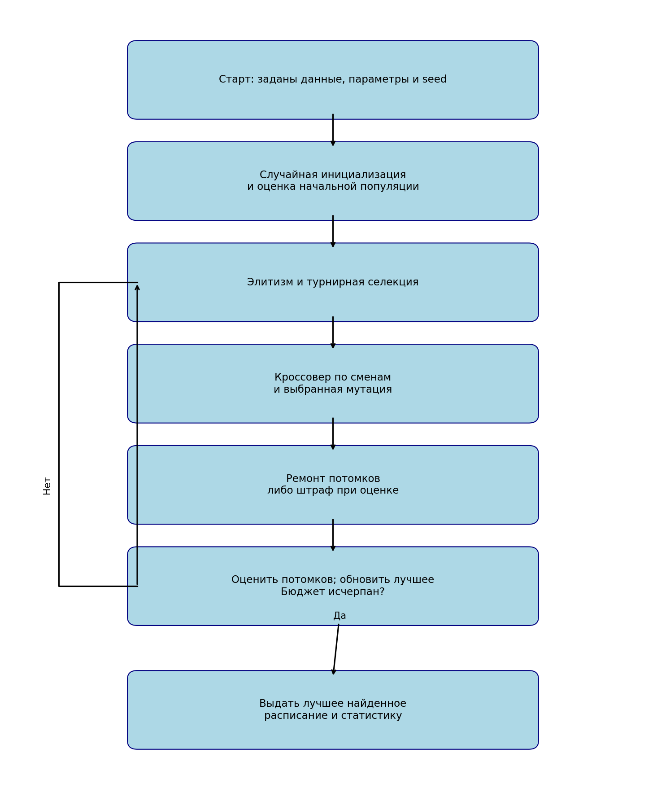
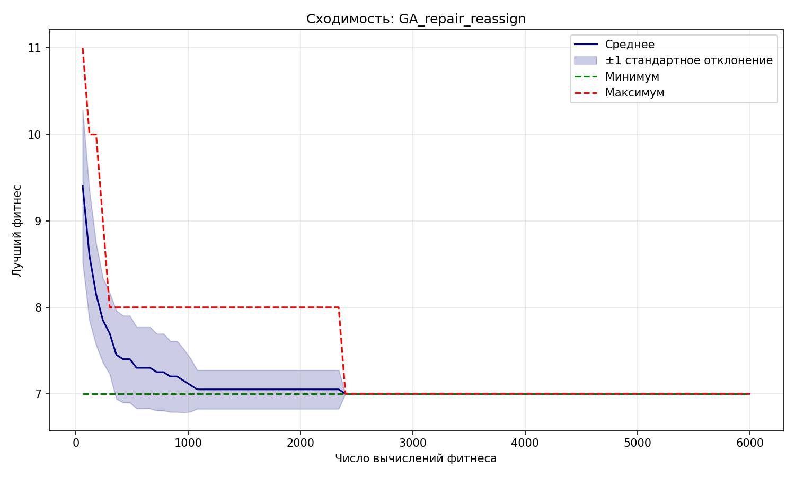
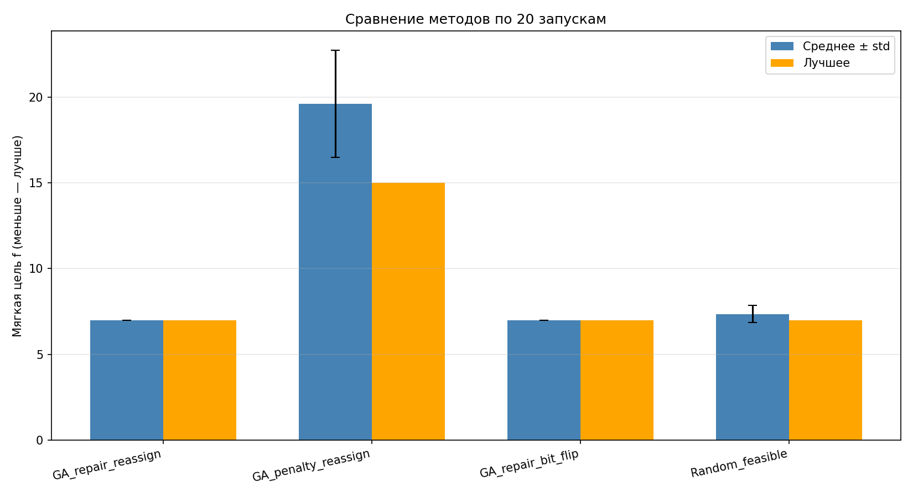

# Отчёт по лабораторной работе № 2

## Генетический алгоритм для составления плана дежурств на неделю

**Вариант:** 10  
**Студент:** Муляр Александр, Б24-527  
**Дата:** 2026-11-03

## 1. Постановка задачи

Требуется составить план дежурств 7 сотрудников на 7 дней. В каждом дне есть утренняя, дневная и ночная смены, всего 21 смена. Каждую смену должен обслужить ровно один сотрудник. Необходимо соблюсти ограничения по сменам и минимизировать неудовлетворённые предпочтения и дисбаланс нагрузки.

Задача решена самостоятельно реализованным генетическим алгоритмом без готовых пакетов оптимизации. Исходный код находится в `duty_ga.py`, демонстрация — в `01_genetic_algorithm.ipynb`, серии экспериментов — в `02_experiments.ipynb`.

## 2. Входные данные

Использованы синтетические данные с фиксированным `data_seed=202610`:

1. Создаются имена 7 сотрудников и матрица предпочтений размера $7\times21$.
2. Каждая ячейка получает значение 0, 1 или 4 с вероятностями 0.25, 0.55 и 0.20 соответственно.
3. Независимо 10% ячеек заменяются на 9 — сотрудник недоступен для этой смены.
4. После генерации конструктивная эвристика проверяет, что экземпляр имеет допустимое решение.

Коды 0, 1 и 4 означают желательную, нейтральную и нежелательную смену. Матрица сохранена в `configs/problem_instance.json`. Масштаб соответствует заданию: 21 событие-дежурство, 147 ограничений на пары смен одного дня и 42 конфликта «ночь — следующее утро».

## 3. Пространство решений и ограничения

Генотип — бинарная матрица

$$x\in\{0,1\}^{7\times21},$$

где $x_{it}=1$, если сотрудник $i$ назначен на смену $t=3d+s$. Здесь $d=0,\ldots,6$ — день, $s=0,1,2$ — смена. Фенотип — таблица дежурств; декодирование заключается в чтении назначенных сотрудников по столбцам матрицы.

Обозначим $L_i=\sum_t x_{it}$. Жёсткие ограничения:

1. **Покрытие:** $\sum_i x_{it}=1$ для каждой смены.
2. **Одна смена в день:** $\sum_{s=0}^{2}x_{i,3d+s}\leq1$ для всех $i,d$.
3. **Отдых:** $x_{i,3d+2}+x_{i,3(d+1)}\leq1$ для $d=0,\ldots,5$; после ночи нельзя назначать следующее утро.
4. **Недельный лимит:** $L_i\leq4$.
5. **Доступность:** $x_{it}=0$, если $p_{it}=9$.

Мягкая цель минимизируется:

$$f(x)=\sum_{i,t}p_{it}x_{it}+2\sum_i(L_i-3)^2.$$

Первое слагаемое — стоимость предпочтений, второе — квадратичный штраф за отклонение нагрузки от средних трёх смен. Предложенное кодирование непосредственно отображает каждое возможное назначение и позволяет вычислять все ограничения без промежуточного вещественного представления.

## 4. Алгоритм и операторы

### 4.1. Общая схема

1. Создать начальную популяцию случайных матриц с одним назначением на смену.
2. При подходе с ремонтом восстановить допустимость каждой особи.
3. Оценить популяцию и сохранить лучшее решение.
4. Пока не исчерпан бюджет:
   - перенести 2 элитные особи;
   - выбрать родителей турнирной селекцией с $k=3$;
   - с вероятностью 0.9 применить кроссовер;
   - применить выбранную мутацию;
   - выполнить ремонт либо оставить нарушения для штрафной оценки;
   - оценить потомков и обновить лучшее решение.
5. Вернуть лучшее найденное решение.

Начальная популяция входит в бюджет. Если на полное поколение не хватает оцениваний, оценивается только оставшееся число особей. Поэтому каждый запуск использует ровно 6000 вычислений.

### 4.2. Специализированные операторы

- **Равномерный кроссовер по сменам.** Каждый столбец ребёнка целиком наследуется от одного из родителей. Это сохраняет структуру назначения и покрытие, если оно выполнялось у родителей.
- **Мутация переназначения.** Для каждой смены с вероятностью 0.15 текущий сотрудник заменяется случайным другим. Покрытие сохраняется, остальные ограничения затем восстанавливаются или штрафуются.
- **Битовая мутация.** Для каждой смены с той же вероятностью инвертируется один случайный бит её столбца. Может возникнуть пустая или множественная смена, поэтому при базовом подходе обязателен ремонт.
- **Ремонт.** Многостартовая жадная процедура последовательно заполняет смены только допустимыми кандидатами. Оценка кандидата включает предпочтение, изменение дисбаланса и соответствие исходному генотипу. При тупике выполняется новая попытка с большей случайностью; исчерпание попыток приводит к явной ошибке.

### 4.3. Два подхода к ограничениям

1. **Ремонт:** фитнес равен $f(x)$, все оцениваемые особи после обработки допустимы.
2. **Штраф:** генотип не ремонтируется, минимизируется $F(x)=f(x)+1000H(x)$, где $H(x)$ — сумма нарушений покрытия, дневных ограничений, отдыха, лимита и доступности. Коэффициент 1000 больше максимально возможной мягкой цели допустимого решения, поэтому найденное допустимое решение всегда предпочтительнее недопустимого.

### 4.4. Базовые параметры

| Параметр | Значение |
|---|---:|
| Число сотрудников / смен | 7 / 21 |
| Максимум смен на сотрудника | 4 |
| Размер популяции | 60 |
| Бюджет вычислений фитнеса | 6000 |
| Турнир | 3 |
| Вероятность кроссовера | 0.9 |
| Вероятность мутации каждой смены | 0.15 |
| Элитизм | 2 |
| Коэффициент штрафа | 1000 |
| Seed одиночного запуска | 42 |
| Seed серий | 1000–1019 |

## 5. Примеры решений

Полные матрицы и таблицы приведены в первом ноутбуке и `results/solution_examples.json`.

| Пример | Мягкая цель | Нарушений | Состав нарушений |
|---|---:|---:|---|
| Допустимое 1, конструктивная эвристика | 11 | 0 | — |
| Допустимое 2, ремонт случайного генотипа | 10 | 0 | — |
| Недопустимое 1, случайное без ремонта | 108 | 9 | 3 дневных, 1 отдых, 2 лимита, 3 доступности |
| Недопустимое 2, намеренно испорченное | 20 | 5 | 2 покрытия, 2 дневных, 1 лимит |

Примеры показывают, что одного назначения на каждую смену недостаточно: случайное решение 1 покрывает все смены, но нарушает остальные ограничения.

## 6. Экспериментальная методика

Для каждого метода выполнены 20 независимых запусков с seed от 1000 до 1019. Во всех запусках использован один входной экземпляр и ровно 6000 оцениваний.

- `GA_repair_reassign` — базовый ГА: ремонт и переназначение.
- `GA_penalty_reassign` — отличается только заменой ремонта штрафом.
- `GA_repair_bit_flip` — отличается только битовой мутацией.
- `Random_feasible` — случайные генотипы, восстановленные тем же ремонтом, без селекции и наследования.

Дополнительно приведена одна конструктивная эвристика. Основной равнобюджетный baseline — случайный допустимый поиск. Статистика качества вычисляется по $f$ только для допустимых решений; доля допустимых результатов указана отдельно.

## 7. Результаты серий

| Метод | Best | Mean | Median | Std | Worst | Доля допустимых | Среднее время, с |
|---|---:|---:|---:|---:|---:|---:|---:|
| GA_repair_reassign | 7 | 7.000 | 7 | 0.000 | 7 | 1.0 | 1.441 |
| GA_penalty_reassign | 15 | 19.600 | 19 | 3.119 | 28 | 1.0 | 0.225 |
| GA_repair_bit_flip | 7 | 7.000 | 7 | 0.000 | 7 | 1.0 | 1.439 |
| Random_feasible | 7 | 7.350 | 7 | 0.489 | 8 | 1.0 | 1.436 |

Все 80 запусков вернули допустимые решения и использовали ровно 6000 оцениваний. Полные данные находятся в отдельных CSV, `results/all_results.json` и `results/summary.csv`. Время зависит от компьютера и приведено только как дополнительная характеристика.

У базового ГА основное улучшение происходит в первые 1000–2400 оцениваний; после 2400 все запуски серии имеют лучшее значение 7.

## 8. Анализ сравнений

### 8.1. Ремонт и штраф

Ремонт дал среднее 7.0 против 19.6 у штрафа, а также лучший результат 7 против 15. При этом штрафная версия была примерно в 6.4 раза быстрее по среднему времени, поскольку не выполняет конструктивное восстановление. На данном экземпляре ремонт существенно лучше по качеству и устойчивости, хотя требует больше времени на одну итерацию. Оба подхода в этих сериях вернули только допустимые итоговые решения.

### 8.2. Две мутации

Переназначение и битовая мутация дали одинаковую статистику: во всех 20 запусках получено $f=7$. Следовательно, при выбранном ремонте и бюджете преимущество одной мутации не обнаружено. Это не означает эквивалентность самих операторов: переназначение сохраняет покрытие, а битовая мутация может его нарушать, но последующий ремонт нивелирует различие.

### 8.3. Сравнение с простыми методами

Базовый ГА уменьшил среднюю цель относительно случайного допустимого поиска с 7.35 до 7.0, то есть примерно на 4.8%. Случайный поиск получил 7 в 13 запусках и 8 в 7 запусках, тогда как ГА стабильно получил 7 во всех 20. Лучший результат обоих методов одинаков, поэтому преимущество ГА заключается в устойчивости, а не в более низком найденном минимуме.

Конструктивная эвристика дала допустимое решение с $f=11$. Лучшее решение ГА улучшает его на 4 единицы, или примерно на 36.4%.

## 9. Лучшее расписание

Лучший результат найден базовым `GA_repair_reassign` при `seed=1000`: $f=7$, стоимость предпочтений 7, дисбаланс 0.

| День | Утро | День | Ночь |
|---|---|---|---|
| Понедельник | Сотрудник 5 | Сотрудник 1 | Сотрудник 3 |
| Вторник | Сотрудник 7 | Сотрудник 1 | Сотрудник 2 |
| Среда | Сотрудник 4 | Сотрудник 6 | Сотрудник 2 |
| Четверг | Сотрудник 7 | Сотрудник 6 | Сотрудник 3 |
| Пятница | Сотрудник 5 | Сотрудник 3 | Сотрудник 4 |
| Суббота | Сотрудник 5 | Сотрудник 4 | Сотрудник 1 |
| Воскресенье | Сотрудник 7 | Сотрудник 2 | Сотрудник 6 |

Каждый сотрудник получил ровно 3 смены. Из 21 назначения 14 попали в желательные смены и 7 — в нейтральные; нежелательных и недоступных назначений нет. Нарушения покрытия, дневных ограничений, отдыха и лимита равны нулю. Машиночитаемые версии: `results/best_schedule.csv` и `results/best_solution.json`.

## 10. Выводы

1. Реализован дискретный ГА с бинарной матрицей, специализированным кроссовером, двумя мутациями, ремонтом, штрафами, турнирной селекцией и элитизмом.
2. Выполнены обязательные сравнения и 20 независимых запусков для каждого из четырёх методов; бюджеты и допустимость проверены по сохранённым результатам.
3. На данном экземпляре ремонт значительно эффективнее штрафа по качеству, но медленнее. Различие двух мутаций после ремонта не проявилось.
4. Базовый ГА устойчиво находит решение с $f=7$, немного превосходя случайный допустимый поиск по среднему и заметно — однократную конструктивную эвристику.
5. Полученное расписание практически приемлемо: все смены покрыты, требования по отдыху и нагрузке соблюдены, нагрузка равномерна, предпочтения преимущественно учтены. Глобальная оптимальность $f=7$ не доказана, поэтому результат следует считать лучшим найденным, а не сертифицированным оптимумом.
